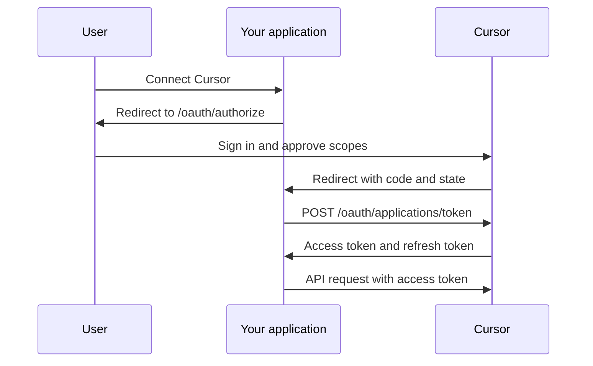

# OAuth Applications

An OAuth application lets software you build act for a Cursor user with that user's consent. The user approves a set of scopes on a Cursor consent page, and your application receives an access token limited to those scopes. No one shares a password or an API key.

OAuth applications are currently available to select partners. For early access, reach out to your account manager.

Cursor uses the OAuth 2.0 authorization code flow with PKCE. Team admins register applications on the **OAuth Applications** page of the [dashboard](https://cursor.com/dashboard).

Use an OAuth application when the user is at your application and you store a client secret. If your backend acts only for members of your own team or organization, use a [trusted issuer](https://cursor.com/docs/security/trusted-issuers.md) instead. An admin approves it once, and members don't see a consent page. See [When to use a trusted issuer](https://cursor.com/docs/security/trusted-issuers.md#when-to-use-a-trusted-issuer).

## Register an application

### Start a new application

On the **OAuth Applications** page, select **New application**.

### Enter the details

Give the application a **Name**. Users see it on the consent screen, along with the optional **Logo**. Under **Redirect URIs**, add each URI that can receive an authorization response.

### Choose scopes

Select the scopes the application can request. Choose the smallest set that works.

### Create and store the credentials

Select **Create application**. Copy the **Client ID** and the client secret into your secret manager. Client IDs start with `oauth_client_`.

Treat OAuth clients as production credentials. Use exact redirect URIs, grant the smallest practical scope set, and keep client secrets in a secret manager.

### Redirect URIs

Cursor sends authorization responses only to a URI that exactly matches one on the list.

- An application can have up to 10 redirect URIs.
- Each must be an absolute HTTPS URL. HTTP is allowed for `localhost` during development.
- A URI can't contain credentials or a fragment.

### Scopes

Scopes fall into three groups, by whose resources they reach:

| Group                | Access                                                                     |
| :------------------- | :------------------------------------------------------------------------- |
| **Personal account** | Resources owned by the person who authorizes the application.              |
| **Teams**            | Only the teams the person explicitly selects during authorization.         |
| **Organizations**    | Only the organizations the person explicitly selects during authorization. |

A user must hold every requested permission before they can approve access. An application can't use consent to gain access its user doesn't have. Most [API key permissions](https://cursor.com/docs/security/api-keys.md#permissions) are available as scopes. Five aren't: **Run Cloud Agents**, **Use Grok Bot**, **Sign in to the Cursor CLI and SDK**, **View model access**, and **Manage model access**.

## Authorize a user

The flow has three steps: send the user to Cursor, receive a code, and exchange the code for tokens.



### 1. Request authorization

Create a PKCE code verifier of 43 to 128 characters and its S256 code challenge. Then send the user's browser to the authorization endpoint:

```text
https://cursor.com/oauth/authorize
  ?response_type=code
  &client_id=YOUR_CLIENT_ID
  &redirect_uri=https%3A%2F%2Fapp.example.com%2Fcallback
  &scope=agent%3A%2A
  &state=RANDOM_STATE
  &code_challenge=YOUR_CODE_CHALLENGE
  &code_challenge_method=S256
```

| Parameter               | Required | Description                                                                 |
| :---------------------- | :------- | :-------------------------------------------------------------------------- |
| `response_type`         | Yes      | Must be `code`.                                                             |
| `client_id`             | Yes      | The application's client ID.                                                |
| `redirect_uri`          | Yes      | Must exactly match a registered redirect URI.                               |
| `scope`                 | Yes      | Space-separated scopes. Each must be one the application is registered for. |
| `state`                 | Yes      | An unguessable value that you check when the user returns.                  |
| `code_challenge`        | Yes      | The PKCE challenge derived from your code verifier.                         |
| `code_challenge_method` | Yes      | Must be `S256`.                                                             |

The example requests `agent:*`, the scope for **Run agents** on a personal account.

### 2. Receive the code

The user signs in to Cursor and sees a consent screen with the application's name, logo, and requested scopes. For team scopes, the user chooses which teams to include.

When the user approves, Cursor redirects to your `redirect_uri` with `code` and `state`. When the user declines, the redirect carries `error=access_denied`. Check that `state` matches the value you sent before you continue.

The authorization code expires after 5 minutes and works once.

### 3. Exchange the code for tokens

Send the code and your code verifier to the token endpoint from your server. The request is form-encoded.

```bash
curl -X POST https://api2.cursor.sh/oauth/applications/token \
  -u "YOUR_CLIENT_ID:YOUR_CLIENT_SECRET" \
  -d grant_type=authorization_code \
  -d code=AUTHORIZATION_CODE \
  -d code_verifier=YOUR_CODE_VERIFIER \
  --data-urlencode "redirect_uri=https://app.example.com/callback"
```

```json
{
  "access_token": "ACCESS_TOKEN",
  "token_type": "Bearer",
  "expires_in": 3600,
  "refresh_token": "REFRESH_TOKEN",
  "scope": "agent:*"
}
```

Authenticate the client with HTTP Basic, as shown, or send `client_id` and `client_secret` in the form body. Don't send both.

Send the access token as a Bearer token on API requests:

```bash
curl https://api.cursor.com/v1/agents \
  -H "Authorization: Bearer ACCESS_TOKEN"
```

## Refresh an access token

Access tokens last 1 hour. Use the refresh token to get a new one.

```bash
curl -X POST https://api2.cursor.sh/oauth/applications/token \
  -u "YOUR_CLIENT_ID:YOUR_CLIENT_SECRET" \
  -d grant_type=refresh_token \
  -d refresh_token=REFRESH_TOKEN
```

Each refresh returns a new refresh token and retires the old one. Store the new token every time. A retired refresh token can't be used again. The request fails with `invalid_grant`.

| Credential         | Lifetime                                                                         |
| :----------------- | :------------------------------------------------------------------------------- |
| Authorization code | 5 minutes, single use                                                            |
| Access token       | 1 hour                                                                           |
| Refresh token      | 90 days without a successful refresh, and never more than 365 days after consent |

When the refresh token expires, send the user through authorization again.

## Check or revoke a token

To check whether a token is still active, call the introspection endpoint:

```bash
curl -X POST https://api2.cursor.sh/oauth/introspect \
  -u "YOUR_CLIENT_ID:YOUR_CLIENT_SECRET" \
  -d token=ACCESS_TOKEN
```

```json
{
  "active": true,
  "client_id": "YOUR_CLIENT_ID",
  "token_type": "Bearer",
  "scope": "agent:*",
  "exp": 1767229200,
  "sub": "USER_SUBJECT"
}
```

`sub` is the account subject identifier of the user who approved access. An expired, revoked, or unknown token returns `{"active": false}`.

To revoke a token when a user disconnects your application, call the revocation endpoint. It returns `200` with an empty object.

```bash
curl -X POST https://api2.cursor.sh/oauth/revoke \
  -u "YOUR_CLIENT_ID:YOUR_CLIENT_SECRET" \
  -d token=REFRESH_TOKEN
```

## Errors

Token endpoint errors use the OAuth 2.0 error format:

```json
{
  "error": "invalid_grant",
  "error_description": "The authorization code was already used"
}
```

| Status | `error`                   | Cause                                                                                  |
| :----- | :------------------------ | :------------------------------------------------------------------------------------- |
| `400`  | `invalid_request`         | A required field is missing or malformed.                                              |
| `400`  | `unsupported_grant_type`  | The grant type isn't `authorization_code` or `refresh_token`.                          |
| `400`  | `invalid_grant`           | The code or refresh token is expired, already used, or no longer authorized.           |
| `400`  | `invalid_scope`           | The request names a scope the application or grant doesn't cover.                      |
| `401`  | `invalid_client`          | Client authentication failed. The response carries a `WWW-Authenticate: Basic` header. |
| `429`  |                           | Too many requests. Wait, then retry with backoff.                                      |
| `503`  | `temporarily_unavailable` | Cursor couldn't complete a check. Retry the request.                                   |

## Manage an application

Each application on the **OAuth Applications** page has these actions:

- **Edit.** Change the name, logo, redirect URIs, or scopes. The client ID and secret stay the same.
- **Rotate secret.** Issue a new client secret. The previous secret keeps working for an overlap period, so you can deploy the new one without downtime.
- **Disable application.** Stop the application from working without deleting it. Disabling revokes the access users granted and the tokens issued to the application. **Enable application** turns it back on, and users authorize it again.
- **Delete application.** Remove the application for good. Its tokens stop working.

## Revoke access

A user ends an application's access by disconnecting from inside the application. The application then calls the revocation endpoint with the user's refresh token, which ends the grant and its access tokens. See [Check or revoke a token](https://cursor.com/docs/security/oauth-applications.md#check-or-revoke-a-token). The user authorizes the application again to restore access.

The dashboard has no per-user control for OAuth applications. **Authorized apps** in the dashboard settings doesn't list OAuth applications.

Admins who need to cut off an application for everyone can disable or delete it.

## Related

- [Trusted issuers](https://cursor.com/docs/security/trusted-issuers.md)
- [API keys and service tokens](https://cursor.com/docs/security/api-keys.md)
- [Security overview](https://cursor.com/docs/security.md)
