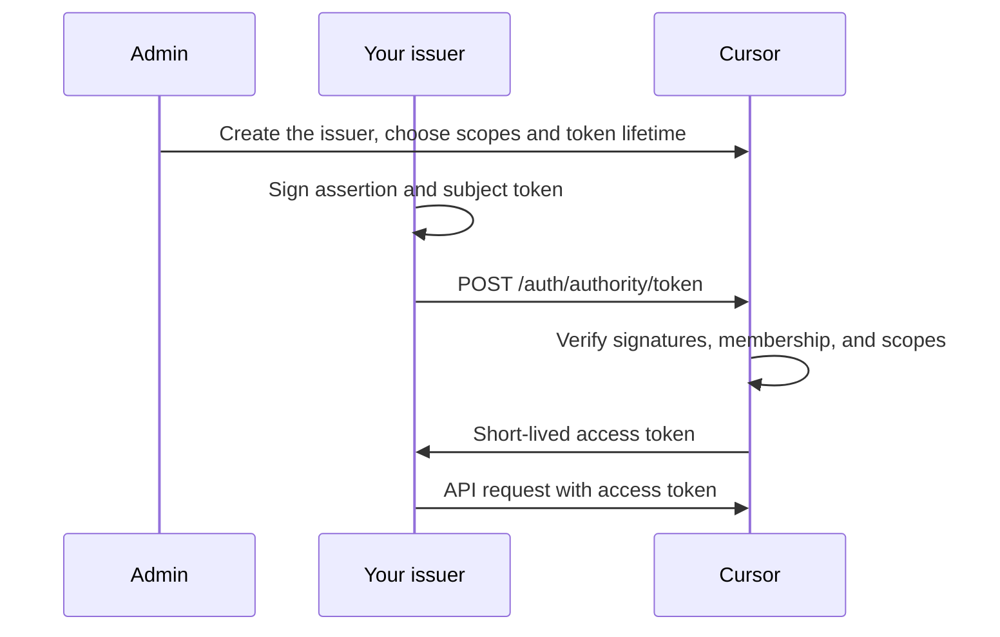

# Trusted issuers

A trusted issuer is a server you run that signs tokens Cursor accepts. Your server signs a short assertion with its private key, and Cursor exchanges it for a short-lived access token that acts for one member of your team or organization.

An admin sets up the issuer once and chooses its scopes and token lifetime. Members don't approve anything. A token works only inside the team or organization that owns the issuer.

Cursor holds only your public keys. Your private key never leaves your server, and there is no client secret or refresh token to store.

## When to use a trusted issuer

Use a trusted issuer when your server and the people it acts for belong to the same team or organization. Use an [OAuth application](https://cursor.com/docs/security/oauth-applications.md) when your application serves users outside it, and each user must approve access.

|                         | Trusted issuer                                                        | [OAuth application](https://cursor.com/docs/security/oauth-applications.md) |
| :---------------------- | :-------------------------------------------------------------------- | :-------------------------------------------------------------------------- |
| **Best for**            | Your own backend, acting for members of your own team or organization | An app that users from any team can connect                                 |
| **Who approves access** | An admin, once, when they set up the issuer                           | Each user, on a Cursor consent page                                         |
| **Who it can act for**  | Members of the team or organization that owns the issuer              | Any user who approves the app                                               |
| **Client proof**        | A JWT signed with your private key                                    | A client secret                                                             |
| **Tokens**              | Short-lived access tokens, no refresh token                           | Access tokens and rotating refresh tokens                                   |

## How it works



1. An admin creates the issuer, chooses its scopes and token lifetime, and registers its public keys in the dashboard.
2. When your server needs to act for a member, it signs two JWTs and posts them to the token endpoint.
3. Cursor verifies them, checks that the member belongs to the issuer's owner, and returns an access token.
4. When the token expires, your server signs a new pair and exchanges again.

## Before you start

- **Role.** You need permission to manage API keys for the owner: a team admin for a team's issuers, or an organization admin for an organization's issuers.
- **A signing key.** Create an RSA or EC key pair on your server. See [Signing keys](https://cursor.com/docs/security/trusted-issuers.md#signing-keys).
- **Members only.** An issuer acts only for members of the team or organization that owns it. Its tokens never reach a member's Personal account or another team.
- **Personal API keys allowed.** Cursor treats tokens from an issuer like the member's personal API keys. If a team turns off personal API key creation, its members can't receive tokens.

## Manage issuers

Issuers live under **Trusted issuers** on the **API Keys** page of the [dashboard](https://cursor.com/dashboard). Cursor may ask you to sign in again before you create or change an issuer.

### Create an issuer

### Open the create page

Under **Trusted issuers**, select **Create issuer** or **New trusted issuer**. Either one opens the **Create trusted issuer** page.

### Enter the details

Enter a **Name**, such as "Production token issuer".

### Choose scopes

Under **Scopes**, select the scopes the issuer can request. Choose the smallest set that works.

### Choose the token lifetime

Set how long each access token lasts. Choose the shortest lifetime that covers the work.

### Create the issuer and copy the client key

Select **Create issuer**, then copy the **Client key** into your issuer's configuration. Client keys start with `authority_client_`.

### Register a public key

Select **Manage keys** in the issuer's menu, or **Register key** on the issuer. Paste one public JWK or upload a JWK file, then select **Register key**.

### Issuer settings

| Setting            | Required         | Rules                                                                                                                                                             |
| :----------------- | :--------------- | :---------------------------------------------------------------------------------------------------------------------------------------------------------------- |
| **Name**           | Yes              | Identifies the issuer in the dashboard.                                                                                                                           |
| **Scopes**         | Yes              | 1 to 32, from the same catalog as [OAuth application scopes](https://cursor.com/docs/security/oauth-applications.md#scopes). A token can carry only these scopes. |
| **Token lifetime** | Yes              | How long each access token lasts. See [Token lifetime and scopes](https://cursor.com/docs/security/trusted-issuers.md#token-lifetime-and-scopes).                 |
| **Public keys**    | Yes, to exchange | Up to 5 active keys. See [Signing keys](https://cursor.com/docs/security/trusted-issuers.md#signing-keys).                                                        |

Cursor verifies your JWTs against the public keys you register. It doesn't fetch keys from a JWKS URL or a discovery document, and there is no issuer URL or claim mapping to configure. The issuer, audience, and subject values are fixed. See [Sign the JWTs](https://cursor.com/docs/security/trusted-issuers.md#sign-the-jwts).

### Signing keys

| Algorithm | Key type               | Required JWK members                 |
| :-------- | :--------------------- | :----------------------------------- |
| `RS256`   | RSA, 2048 bits or more | `kty`, `alg`, `use`, `n`, `e`        |
| `ES256`   | EC, curve P-256        | `kty`, `alg`, `use`, `crv`, `x`, `y` |

- Set `use` to `sig` and `alg` to the algorithm in the table.
- Leave out `kid`. Cursor assigns each key a key ID and shows it in the issuer's key list. Put that ID in the `kid` header of every JWT you sign with the key.
- Register the public key only. A JWK with private key members, or with members other than those listed, is refused.

An issuer can hold more than one key, so you can register a new key before you stop signing with the old one.

### Edit an issuer

Open the issuer's menu and select **Edit issuer**, or select **Edit** on the issuer. You can change the name, scopes, and token lifetime. The client key stays the same.

Changes apply to new exchanges. If you remove a scope, new tokens no longer include it.

### Disable or delete an issuer

Each issuer has these actions in its menu. **Revoke key** is in the issuer's key list.

| Action             | Effect on the issuer                                                              | Effect on existing tokens                                                              |
| :----------------- | :-------------------------------------------------------------------------------- | :------------------------------------------------------------------------------------- |
| **Disable issuer** | Exchanges are refused. Keys are kept. **Enable issuer** turns it back on.         | Tokens stop working while the issuer is disabled.                                      |
| **Revoke key**     | The key stops verifying JWTs.                                                     | Every token the issuer minted is revoked, including tokens signed with its other keys. |
| **Revoke issuer**  | Permanent. This is how you delete an issuer. It can't be edited or enabled again. | Every token is revoked.                                                                |

These actions apply to tokens that are already issued, not only to new exchanges.

If a signing key is exposed, revoke that key, register a new one, and resume exchanges.

## Exchange an assertion for a token

### Sign the JWTs

Your server signs two JWTs for each exchange, both with a key registered for the issuer:

- **The assertion** proves the request comes from your issuer.
- **The subject token** names the member and the scopes you want.

Both use the same header, with a different `typ`:

```json
{
  "alg": "ES256",
  "kid": "YOUR_KEY_ID",
  "typ": "authority-assertion+jwt"
}
```

The subject token's `typ` is `authority-subject+jwt`.

Assertion claims:

```json
{
  "iss": "YOUR_CLIENT_KEY",
  "sub": "YOUR_CLIENT_KEY",
  "aud": "https://api2.cursor.sh/auth/authority/token",
  "iat": 1767225600,
  "exp": 1767225660,
  "jti": "UNIQUE_ASSERTION_ID",
  "subject_token_sha256": "BASE64URL_SHA256_OF_SUBJECT_TOKEN"
}
```

Subject token claims:

```json
{
  "iss": "YOUR_CLIENT_KEY",
  "sub": "USER_SUBJECT",
  "aud": "cursor-authority-mint:api2.cursor.sh",
  "scopes": ["team.members.read"],
  "iat": 1767225600,
  "exp": 1767225660,
  "jti": "UNIQUE_SUBJECT_ID"
}
```

| Claim                  | Assertion                                                                        | Subject token                                                                                                                                                                              |
| :--------------------- | :------------------------------------------------------------------------------- | :----------------------------------------------------------------------------------------------------------------------------------------------------------------------------------------- |
| `iss`                  | The issuer's client key.                                                         | The issuer's client key.                                                                                                                                                                   |
| `sub`                  | The issuer's client key.                                                         | The account subject identifier of the member. It's the value [OAuth token introspection](https://cursor.com/docs/security/oauth-applications.md#check-or-revoke-a-token) returns as `sub`. |
| `aud`                  | The token endpoint URL, as one string.                                           | `cursor-authority-mint:` followed by the host of the token endpoint.                                                                                                                       |
| `iat`, `exp`           | Required. Keep the lifetime at 60 seconds or less.                               | Required. The lifetime can't exceed 5 minutes.                                                                                                                                             |
| `jti`                  | Required. Accepted once.                                                         | Required. Accepted once.                                                                                                                                                                   |
| `subject_token_sha256` | The SHA-256 hash of the subject token string, base64url-encoded without padding. | Not used.                                                                                                                                                                                  |
| `scopes`               | Not used.                                                                        | An array of the scopes to grant. Each must be one of the issuer's scopes.                                                                                                                  |

Both JWTs follow these rules:

- The header can contain only `alg`, `kid`, and `typ`.
- Each JWT can be at most 8 KiB.
- Cursor allows 30 seconds of clock skew.
- A `jti` can't be reused. Sign a fresh pair for every exchange.

### Token request

Post the pair to `POST /auth/authority/token` as a form:

```bash
curl -X POST https://api2.cursor.sh/auth/authority/token \
  -d grant_type=urn:ietf:params:oauth:grant-type:jwt-bearer \
  -d client_id=YOUR_CLIENT_KEY \
  -d assertion=SIGNED_ASSERTION_JWT \
  -d subject_token=SIGNED_SUBJECT_JWT \
  -d expires_in=900
```

| Field           | Required | Description                                                                                |
| :-------------- | :------- | :----------------------------------------------------------------------------------------- |
| `grant_type`    | Yes      | Must be `urn:ietf:params:oauth:grant-type:jwt-bearer`.                                     |
| `client_id`     | Yes      | The issuer's client key.                                                                   |
| `assertion`     | Yes      | The signed assertion JWT.                                                                  |
| `subject_token` | Yes      | The signed subject JWT.                                                                    |
| `expires_in`    | No       | A shorter token lifetime than the issuer's setting, as a positive whole number of seconds. |

### Token response

```json
{
  "access_token": "ACCESS_TOKEN",
  "token_type": "Bearer",
  "expires_in": 900,
  "scope": "team.members.read"
}
```

`scope` is a space-separated list of the scopes the token carries. Send the access token as a Bearer token on API requests:

```bash
curl https://api.cursor.com/teams/members \
  -H "Authorization: Bearer ACCESS_TOKEN"
```

### Token lifetime and scopes

- An admin sets the token lifetime on the issuer. Set `expires_in` in the request to ask for a shorter one. Read `expires_in` in the response for the value you got.
- A token carries only the scopes in the subject token, and each must be one of the issuer's scopes.
- A token reaches only the team or organization that owns the issuer. It never reaches a member's Personal account.
- There is no refresh token. Exchange again when the token is close to expiry.

Ask for the shortest lifetime that covers the work.

## Errors

Errors use the OAuth 2.0 error format:

```json
{
  "error": "invalid_scope",
  "error_description": "DESCRIPTION"
}
```

The wording of `error_description` can change, so branch on `error`.

| Status | `error`                                                      | Cause                                                                                                                                                                                      | What to do                                                                                                        |
| :----- | :----------------------------------------------------------- | :----------------------------------------------------------------------------------------------------------------------------------------------------------------------------------------- | :---------------------------------------------------------------------------------------------------------------- |
| `400`  | `invalid_request`                                            | `client_id`, `assertion`, or `subject_token` is missing, or `expires_in` isn't a positive whole number.                                                                                    | Fix the request.                                                                                                  |
| `400`  | `unsupported_grant_type`                                     | `grant_type` isn't the JWT-bearer grant.                                                                                                                                                   | Fix the request.                                                                                                  |
| `400`  | `invalid_grant`                                              | A JWT has a bad signature, wrong claims, an expired lifetime, or a reused `jti`. Or the user is unknown, or isn't a member of the team or organization that owns the issuer.               | Check your claims and clock, then sign a new pair. Check that the user still belongs to the team or organization. |
| `400`  | `invalid_scope`                                              | The requested scopes are empty, or include a scope the issuer isn't registered for.                                                                                                        | Request fewer scopes, or ask an admin to add the scope to the issuer.                                             |
| `401`  | `invalid_client`                                             | The client key is unknown, the issuer is disabled or revoked, or it has no registered key. The response carries a `WWW-Authenticate: Bearer` header.                                       | Check the client key, the issuer's status, and its keys.                                                          |
| `403`  | `access_denied`                                              | A team the user belongs to has turned off personal API key creation.                                                                                                                       | Ask that team's admin to allow it, or stop exchanging for this user.                                              |
| `403`  | `team_ip_allowlist_violation`                                | The request came from an address that isn't on the [IP allowlist](https://cursor.com/docs/security/network-controls.md#ip-allowlist) of one of the user's teams, or of their organization. | Call from an address on that list, or ask its admin to add your issuer's egress addresses.                        |
| `403`  | `tenant_restriction_violation`                               | Your network adds a [tenancy restriction](https://cursor.com/docs/enterprise/tenancy-restriction.md) to the request, and it doesn't allow the user's account.                              | Exchange for an account the restriction allows, or update the restriction.                                        |
| `429`  |                                                              | Too many requests.                                                                                                                                                                         | Slow down, then retry with backoff.                                                                               |
| `503`  | `temporarily_unavailable` or `team_ip_allowlist_unavailable` | Cursor couldn't complete a check.                                                                                                                                                          | Retry with backoff.                                                                                               |

`invalid_grant` returns the same description for every cause, and `invalid_client` does the same. Check the JWT rules and the issuer's status when you see them.

## Operate an issuer safely

- **Keep the private key in a KMS or HSM.** Sign through the key service, and never export the key.
- **Request narrow scopes.** Ask for the scopes one task needs in each subject token, not everything the issuer allows.
- **Keep tokens short.** Choose a short token lifetime on the issuer, set `expires_in` to match the work, and don't store access tokens.
- **Sync your clock.** A drifting clock causes `invalid_grant`.
- **Call from known addresses.** Each exchange is checked against the [IP allowlists](https://cursor.com/docs/security/network-controls.md#ip-allowlist) of the teams and organization of the user the token is for. Make sure your issuer's egress addresses are on those lists.
- **Review the audit log.** Each exchange is recorded for the issuer's owner. See [Audit logs](https://cursor.com/docs/enterprise/compliance-and-monitoring.md#audit-logs).

## Related

- [OAuth Applications](https://cursor.com/docs/security/oauth-applications.md)
- [API keys and service tokens](https://cursor.com/docs/security/api-keys.md)
- [Security overview](https://cursor.com/docs/security.md)
